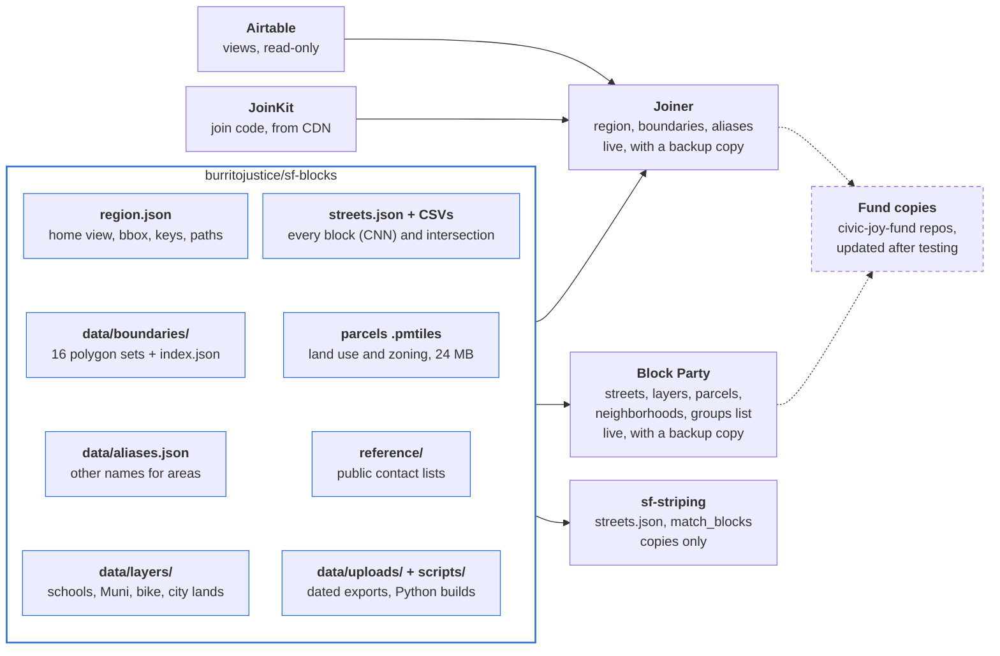

# sf-blocks and the apps that use it

What's in sf-blocks, how Joiner, Block Party and sf-striping use it, how Airtable fits in, and what's next. As of 2026-10-28.

## Overview

[burritojustice/sf-blocks](https://github.com/burritojustice/sf-blocks) is the one place San Francisco's map data is downloaded, cleaned and edited. Joiner and Block Party read it live from its GitHub Pages site and keep a backup copy; sf-striping keeps a copy of the street data.

- **Building blocks of a city.** Boundaries to join to, city layers to draw, street blocks to look up, public contact lists, and the scripts that build each. Another city can start its own repo with the same folders (nyc-blocks, london-blocks) and point the apps at it.
- **Live, with a backup.** Apps load `https://burritojustice.github.io/sf-blocks/<path>`. If that fails, or one file is missing, they use the copy in their own repo, stamped with the sf-blocks version it came from (`data/sf-blocks.json`). `?sfblocks=local` forces the copy.
- **burritojustice first.** [burritojustice/joiner](https://github.com/burritojustice/joiner) and [burritojustice/block-party](https://github.com/burritojustice/block-party) are the primary, unbranded versions. Civic Joy Fund's repos are updated from them after testing, and other organizations can run their own customized copies.
- **Shared code, separate data.** Join logic (name matching, classing, hexbins, dissolve, placing points and lines) lives in JoinKit in [burritojustice/maplibre](https://github.com/burritojustice/maplibre/tree/main/joinkit). sf-blocks holds data and the Python scripts that build it.

<picture>
  <source media="(prefers-color-scheme: dark)" srcset="apps-and-data-dark.svg">
  
</picture>

Arrows show which way data flows: sf-blocks feeds the three apps, Joiner also takes rows from Airtable and its join code from JoinKit, and the Civic Joy Fund copies are updated from Joiner and Block Party.

**The same diagram in Mermaid.** GitHub draws this one from the text below, so it can be edited right here in the browser; the SVGs above are drawn by hand and match the shared doc. Keep whichever works better and delete the other.

Current versions: sf-blocks 2026.10.27.2, Joiner v43, Block Party v37.

## What's in sf-blocks

Each kind of file has its own folder; the data files are built by scripts in `scripts/` from a dated download in `data/uploads/`. Each folder under `data/` has a README with its sources and how to rebuild it.

| Path | What it holds | Built by | Size |
| --- | --- | --- | --- |
| `region.json` | Name, home view, bounding box, Protomaps keys by site, and the path to each kind of data. What an app reads first | by hand | 1 KB |
| `data/boundaries/` | 16 polygon sets to join to, `index.json` (the manifest apps read) and `sources.json` (DataSF id, join key, name field, fields kept, match rules for each) | `get_layers.py` | 7.2 MB |
| `data/aliases.json` | Other names people use for areas, by set: "South Bayshore" → Bayview, "Calle 24" → Calle 24 Latino Cultural District. The only alias list | by hand | 2 KB |
| `data/layers/` | City layers drawn on maps: schools, fire and police stations, health care (points); Muni, bike network, Slow Streets (lines); city-owned lands (polygons) | `build_layers.py` | 2.5 MB |
| `data/Land_Use_with_Active_Parcel_Information.pmtiles` | Parcels with land use and zoning, as vector tiles | one-off (command in Block Party's v32 notes) | 24 MB |
| `data/sf_streets.csv`, `sf_intersections.csv`, `streets.json` | Every street block (CNN) and intersection; `streets.json` is the compact build with slopes and neighborhood fields | `build_data.py --slopes --areas` | 11.6 MB |
| `data/uploads/` | Raw DataSF exports with dates in their names, and Who's On First's SF data. Never edited by hand | downloads | 12 MB |
| `reference/` | Public contact lists: SF Planning's neighborhood group list (plus `neighborhood_groups.json`), Cultural Districts contacts template | `build_neighborhood_groups.py`; by hand | 0.4 MB |

**The 16 boundary sets:** supervisor districts (11), ZIP codes (27), five neighborhood sets (SF Find 117, Analysis 41, Planning 37, Realtor 92, Who's On First 116), census tracts (242), Cultural Districts (10), Bay Area counties (9) and ZIPs (323), election precincts (514), and US House (4), State Senate (3), Assembly (4) and BART (3) districts merged from the precincts.

**Matching scripts:** `match_blocks.py` turns written block descriptions ("Sanchez between 27th and Duncan", "100 block of Winfield") into CNNs. `match_polygons.py` lists the blocks and intersections inside polygons. All scripts are plain Python with no extra packages.

## How the apps use it

Joiner and Block Party both start from `region.json` and fall back to their own copies file by file; sf-striping copies only the street data and matcher.

| App | What it reads from sf-blocks | How | What stays in the app |
| --- | --- | --- | --- |
| [Joiner](https://github.com/burritojustice/joiner) | `region.json`, `data/boundaries/` (manifest and all 16 sets), `data/aliases.json` | Live, with copies in `data/` (sf-blocks 2026.10.27). `js/sfblocks.js` does the loading; hover the logo for the version and whether it's live | Which tab each set goes in, label templates, uploaded polygons, H3 hexbins (made in the browser), `reference/` lists that go with its sets |
| [Block Party](https://github.com/burritojustice/block-party) | `region.json`, `streets.json`, `data/layers/`, the five neighborhood sets, the parcels pmtiles, `neighborhood_groups.json` | Live, with copies in `data/` and `reference/` (sf-blocks 2026.10.27). Hover the title for the version. The pmtiles file has no per-file fallback | The cards, filters, exports, the Apply button and its form link |
| [sf-striping](https://github.com/burritojustice/sf-striping) | `streets.json`, `match_blocks.py` | Copies only, each with its sf-blocks version line | The striping diagrams and their PDFs |
| [JoinKit](https://github.com/burritojustice/maplibre/tree/main/joinkit) (Selecter, Joiner) | Nothing; it's code | Pinned commit from jsDelivr, with a vendor copy in Joiner | Name matching, classes, hexbins, dissolve, point and line placement |

**Refreshing the copies.** Each app has `scripts/copy_sf_blocks.py`, which copies the files it uses from a checkout of sf-blocks and updates `data/sf-blocks.json` with the version. Run it after an sf-blocks release, then ship the app as its own PR. Each app's `data/README.md` lists its copies and how it loads them.

**Testing against another copy.** `?sfblocks=<url>` reads from a fork or a local server, which is how a new city's repo or an unreleased sf-blocks branch gets tried out.

**The Civic Joy Fund copies** (civic-joy-fund/joiner and block-party) still hold their own data and the fund's branding. They get the sf-blocks loading once the burritojustice versions have run for a while; they'll use the civic-joy-fund.github.io Protomaps key, which `region.json` already carries.

## Updating the data

Every change lands in sf-blocks first, as a PR with a new date-style `VERSION`; the apps see it live as soon as it merges.

1. **Get the file.** Export the dataset from DataSF (Export › GeoJSON or CSV) and save it in `data/uploads/` with its date in the name (`Cultural_Districts_20261025.geojson`). The scripts can also download from DataSF's API, but Claude's cloud sessions can't reach data.sf.gov, so in those sessions attach the export instead.
2. **Rebuild.**
   - Boundaries: `python3 scripts/get_layers.py --file <set>=<export>` (add the set to `data/boundaries/sources.json` first if it's new). Rewrites the set and `index.json`.
   - City layers: `python3 scripts/build_layers.py`. Finds the newest file for each source in `data/uploads/`.
   - Streets: `python3 scripts/build_data.py --slopes --areas`. Always the full build, so the slope and neighborhood fields stay.
   - Neighborhood groups: save SF Planning's new list in `reference/neighborhood-groups/` with its date, then `python3 scripts/build_neighborhood_groups.py`.
3. **Names that don't match.** Add them to `data/aliases.json` under the set's id, never in an app.
4. **Release.** Bump `VERSION`, the version line of any script you changed, and `CHANGELOG.md`; open the PR. After it merges, the Pages site updates within a minute or two.
5. **Refresh the backups.** In Joiner and Block Party, run `scripts/copy_sf_blocks.py` and ship each as its own version.

**Don't move or rename a published file.** Apps load it by path, so a move breaks every app that hasn't updated. Add the new path, keep the old one until the apps have moved, then remove it.

**Public contacts only in `reference/`.** What the city or the organization publishes, with `source_url` and `checked` on every hand-built row. Private contacts never go in a repo.

## Airtable

Joiner reads Airtable directly from the browser with each person's own token, read-only; nothing writes back to Airtable yet, and Block Party doesn't connect to it at all.

**Getting in.** In Load data › Airtable, paste a view link (`https://airtable.com/app…/tbl…/viw…`) and a [personal access token](https://airtable.com/create/tokens) with `data.records:read` and `schema.bases:read`.

- The token stays in the browser tab (sessionStorage) until the tab closes and is sent only to `api.airtable.com`.
- The page address carries the view link (`?airtable=…`), never the token, so a shared link asks the next person for their own token.
- Once a token is in, Joiner lists the bases and tables it can see ("token: N bases, M tables") and keeps that list for the tab, so picking another table is quick.

**What's loaded.**

- The view's rows, 100 per request, about 4 requests a second to stay under Airtable's limit of 5, with a progress toast. Each row keeps its record id (`_airtable_id`).
- **Contact fields are left out:** email, phone, attachments, Airtable users, and fields named like an address or contact info. The panel lists what was left out, and any can be added back for that load.
- **Linked records are followed.** Fields of the linked table come in as "Link: Field" columns. A linked field named `wkt`, `geom`, `geometry` or `shape` becomes the row's location, and several linked records' shapes are combined into one. This is how a table with no coordinates gets drawn on the map: link it to a geo table.
- **Save** writes a snapshot file with the rows and settings. It holds every loaded column, so remove names, emails and phone numbers before sharing one.

**The geo tables.** "Block Party 2025 geo" and "Block Party 2026 geo" in the Block Party base have one record per matched block. Each comes from that year's application locations run through `match_blocks.py`, with the CNN, the block's geometry as WKT, and the district, ZIP and neighborhood worked out from sf-blocks' boundaries. Linking applications to these records gives Joiner their locations and lets it join them to any boundary set.

**What stays out of Airtable.** Public contact lists (Cultural Districts, Planning's neighborhood groups) live in sf-blocks' `reference/`, so organizations without Airtable can use them. Street data stays in sf-blocks too; at about 16,000 blocks it's well past what an Airtable table handles comfortably.

## Roadmap

The join to a geo table is step one; next come joining by street block, comparing two lists, and writing what Joiner works out back to Airtable. Nothing below has a date yet.

| Item | What it adds | Waiting on |
| --- | --- | --- |
| **Join by CNN lists** | Rows that list street blocks ("CNN 1234000, 1235000") count toward each block's areas, the way cells listing several neighborhoods do now. Uses `streets.json` from sf-blocks | Nothing; next in line for Joiner |
| **Cross-reference two files** | Load two sources at once, such as block party applications and Planning's neighborhood groups, and see which areas have one, the other, or both | Three decisions: a map or an outreach list as the result, how "Citywide" groups count, and whether both must use the same area set |
| **Lines counted in each area they cross** | An option beside today's "count once, where most of it is", for sets that don't tile the city (Cultural Districts) | A go-ahead |
| **Write area IDs back to Airtable** | Fill or confirm the district, ZIP and neighborhood fields on applications from the boundaries, so the hand-entered values can be checked and replaced | A write token (`data.records:write`) or an Airtable automation; who gets to run it |
| **Match free-text locations inside Airtable** | New applications get their CNN without leaving Airtable, from an automation script calling the block matcher | Stakeholder talks; a web version of the matcher (`match.js`) |
| **Block Party → Airtable form** | The Apply button opens the application form with the block filled in, or shows the form inside Block Party. Hidden on the burritojustice build, shown on the fund's copy | Stakeholders choosing prefill or embed, and the form link |
| **Table and view picker; map inside Airtable** | Choose a base, table and view from a list instead of pasting a link; later, embed the map in an Airtable interface | Nothing for the picker (the catalog is already cached) |
| **Sign-in** | Google sign-in to read Sheets shared only with certain accounts, and one sign-in (possibly Firebase) for the fund's users across Airtable and Google | A Google Cloud project and OAuth consent screen |
| **Web block matcher** | Drag a CSV onto a map, match its rows to blocks by street, cross streets or address, and export the result. A port of `match_blocks.py` and `match_polygons.py` to `match.js` | Nothing; larger piece of work |
| **Neighborhood set comparison** | How the five neighborhood sets overlap, area by area, to back up the name crosswalk | Nothing |
| **Other cities** | A region picker or `?region=` that opens nyc-blocks or london-blocks from their `region.json` | A second city's repo to try it with |
| **Civic Joy Fund copies** | civic-joy-fund/joiner and block-party switch to sf-blocks live loading, keeping their branding and key | The burritojustice versions running well for a while |
| **Block Party extras** | School enrollment from the California Department of Education on the schools layer; a slimmer parcels file; Spanish and Chinese | Enrollment workflow; translations |
